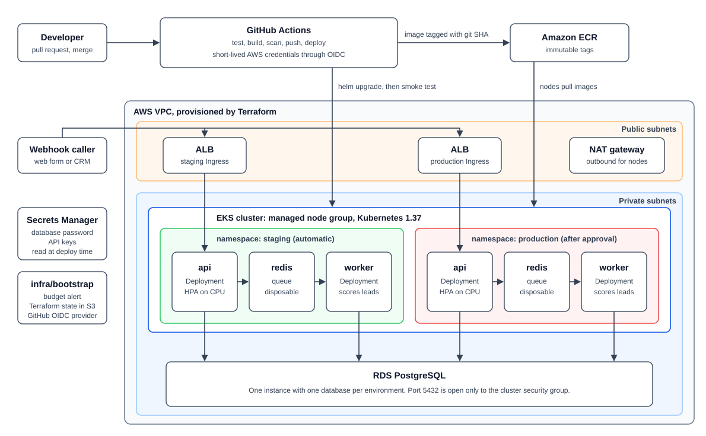
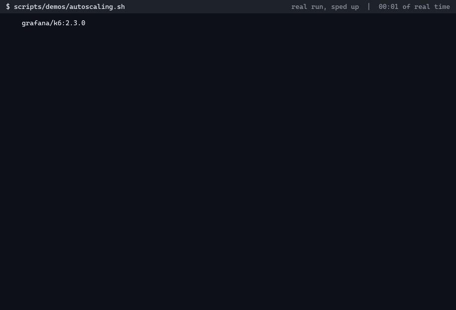
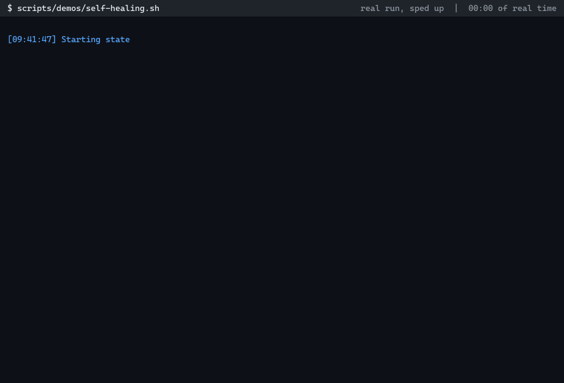
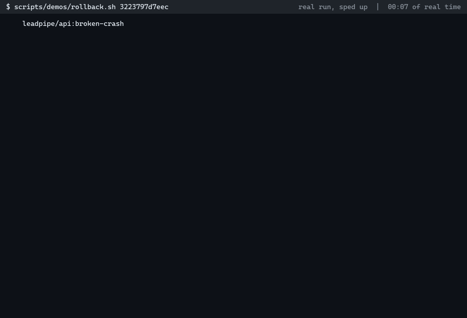
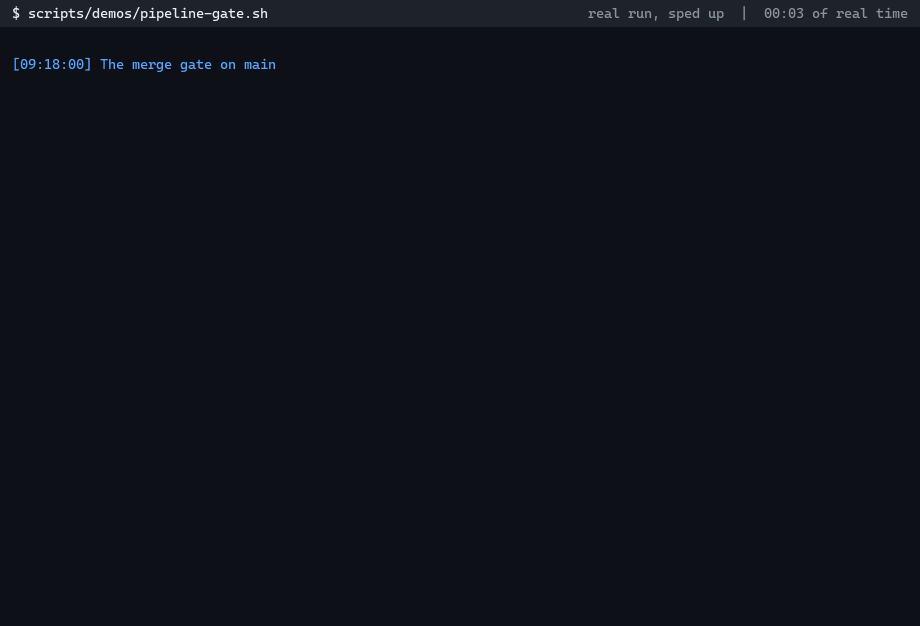
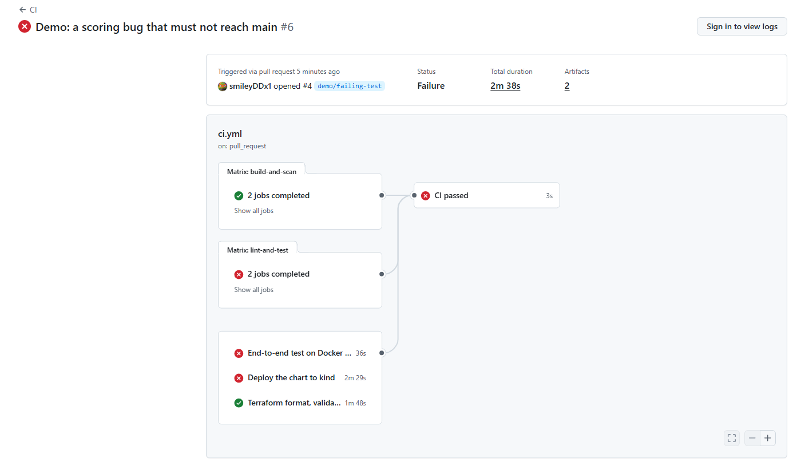

# LeadPipe

[](https://github.com/smileyDDx1/leadpipe/actions/workflows/ci.yml)

LeadPipe receives leads through a webhook, scores them in the background, and stores the results.

The app is small on purpose: two Python services, PostgreSQL and Redis. The substance of the project is the infrastructure around it: containers, CI/CD, Terraform for AWS, and a Helm chart that deploys to both a local kind cluster and EKS.

## Project status

Everything below has run, either locally or on GitHub, except the parts that need an AWS account. Those parts are written and checked, but they have not run for real yet.

| Area | Status |
| --- | --- |
| App, unit tests, Docker Compose | Verified locally |
| Helm chart on kind, with probes, migration Job and smoke test | Verified locally |
| Autoscaling, self-healing and rollback demos on kind | Verified locally |
| Terraform | Validated and tested offline against a mocked AWS provider. **Never applied to real AWS.** |
| CI pipeline (`ci.yml`) | **Passes on GitHub.** |
| Pipeline gate demo | Ran on GitHub, not locally. A real pull request failed CI and was blocked. |
| Deploy and Terraform pipelines (`deploy.yml`, `terraform.yml`) | Need AWS. `deploy.yml` skips cleanly without it. **Neither has done a real run.** |
| ALB Ingress and the AWS Load Balancer Controller | Rendered and schema-checked only. **Never run.** |

[Full details are in the Status section](#status), and [docs/progress.md](docs/progress.md) tracks progress against the original brief.

## What it does

1. `POST /leads` validates the lead, saves it to PostgreSQL, and adds a job to a Redis stream.
2. The worker reads the job, scores the lead, flags duplicates, and updates the record.
3. `GET /leads/{id}` and `GET /stats` return the results.

| Endpoint | Purpose | Needs `X-API-Key` |
| --- | --- | --- |
| `POST /leads` | Accept a lead. Returns 202 and the lead's ID. | Yes |
| `GET /leads/{id}` | Read a lead and its score. | Yes |
| `GET /stats` | Counts by status and grade, duplicates, average score. | Yes |
| `GET /healthz` | Liveness. Checks no dependencies, because a restart would not fix a database outage. | No |
| `GET /readyz` | Readiness. Returns 503 if PostgreSQL is down. If only Redis is down it returns 200 and reports `degraded`, because leads can still be saved. | No |

Scoring is simple rules, with a maximum of 100:

| Signal | Points |
| --- | --- |
| Job title | C-level or founder 40, VP or director or head 30, manager or lead 20, any other title 10, none 0 |
| Company size | 1000+ is 30, 200+ is 25, 50+ is 20, 10+ is 10, smaller is 5, unknown is 0 |
| Source | Referral 30, website form or event 20, CRM 15, paid ads 10, other 5 |

A score of 70 or more is `hot`, 40 or more is `warm`, and anything lower is `cold`. A lead whose email matches an earlier lead is flagged, and it points to the original.

## Architecture



Four design decisions shape the rest of the project.

**The same chart deploys everywhere.** kind and EKS use one Helm chart, and only the values change. PostgreSQL stays outside the chart in both: RDS on AWS, and a plain manifest on kind.

**Redis is disposable.** Every lead is committed to PostgreSQL before its job is queued. If Redis loses its data, the worker's sweep finds leads still marked `pending` and queues them again. Jobs can therefore arrive twice, so scoring is safe to repeat.

**Terraform stops at AWS.** Terraform creates AWS resources only. `scripts/cluster-bootstrap.sh` and `scripts/deploy.sh` handle everything inside the cluster. This keeps pull request plans read-only against AWS, and avoids configuring a Kubernetes provider from a cluster the same config creates.

**No long-lived AWS keys exist.** GitHub Actions gets short-lived credentials through OIDC. Each AWS role trusts one exact GitHub context.

## Repository layout

```text
leadpipe/
├── app/
│   ├── api/                 FastAPI service, migrations, tests, Dockerfile
│   └── worker/              Queue consumer, scoring rules, tests, Dockerfile
├── docker-compose.yml       Full local stack
├── helm/leadpipe/           Chart, plus values-local, values-staging and values-prod
├── deploy/kind/             kind cluster config and the local PostgreSQL manifest
├── infra/
│   ├── bootstrap/           Budget alert, state bucket, GitHub OIDC provider, Terraform roles
│   ├── modules/             vpc, eks, rds, ecr, iam, each with offline tests
│   └── main/                Root config that wires the modules together
├── loadtest/                k6 script for the autoscaling demo
├── scripts/                 Deploy, kind setup, cluster bootstrap, teardown, validation, demos
├── .github/workflows/       ci.yml, deploy.yml, terraform.yml
└── docs/                    Architecture diagram, runbook, demo GIFs and transcripts
```

## Run it locally

### Docker Compose

You need Docker and Python 3. One command starts the API, worker, PostgreSQL and Redis:

```bash
docker compose up --build --wait
```

Run the end-to-end check:

```bash
python scripts/e2e_check.py
```

Or send a lead yourself. This one scores 75 (VP 30, company size 25, website form 20), which is `hot`:

```bash
curl -X POST http://localhost:8000/leads -H 'X-API-Key: local-dev-key' -H 'Content-Type: application/json' -d '{"email":"asha@example.com","name":"Asha Rao","job_title":"VP of Sales","company_size":250,"source":"website_form"}'
```

The API docs are at `http://localhost:8000/docs`. The defaults are for local development only. Copy `.env.example` to `.env` to change them.

Stop the stack and delete its data:

```bash
docker compose down --volumes
```

### kind

You need Docker, kind, kubectl and Helm 4. On Windows, run the scripts from Git Bash.

This creates the cluster, installs metrics-server, builds and loads the images, and deploys with the same script GitHub Actions uses:

```bash
scripts/kind-up.sh
```

Reach the API and run the end-to-end check:

```bash
kubectl -n leadpipe port-forward svc/leadpipe-api 8080:80
```

```bash
python scripts/e2e_check.py http://localhost:8080
```

Delete the cluster:

```bash
kind delete cluster --name leadpipe
```

## Run it on AWS

> **These steps have not been run yet.** Expect to fix problems the first time through.

### Cost warning

EKS, NAT, RDS and load balancers bill by the hour whether or not anything is using them. Run this only for testing and demos, and tear it down afterwards. Bootstrap creates a budget alert, so apply it first.

This is an **estimate** for the default settings in `ap-south-1`. Several figures come from other regions or third-party trackers, so check the [AWS Pricing Calculator](https://calculator.aws/) before relying on them.

| Item | Rough cost per hour | Where the figure comes from |
| --- | --- | --- |
| EKS control plane | $0.10 | [AWS EKS pricing](https://aws.amazon.com/eks/pricing/). Extended support is $0.60, so the cluster is set to standard support only. |
| 2 `t3.medium` nodes | $0.09 | Rough figure, not checked against an AWS page |
| 1 NAT gateway | $0.05 | [AWS VPC pricing](https://aws.amazon.com/vpc/pricing/) lists $0.045 for US East (Ohio), plus $0.045 per GB |
| 2 ALBs | $0.05 | [AWS ELB pricing](https://aws.amazon.com/elasticloadbalancing/pricing/) example uses $0.0225 each in US East (N. Virginia), plus usage |
| `db.t4g.micro` | $0.02 | Third-party price tracker, not checked against an AWS page |
| About 5 public IPv4 addresses | $0.03 | [AWS VPC pricing](https://aws.amazon.com/vpc/pricing/) lists $0.005 each |
| **Total** | **About $0.34, or about $8 a day** | Storage and data transfer add a little more |

The default budget is $40 a month, so a cluster left running would pass it in about 5 days.

### Setup

You need an AWS account with admin access, the AWS CLI, Terraform 1.11 or later, Helm 4, kubectl, jq, and the GitHub CLI. Create the GitHub repository first, because the roles trust it by name.

**1. Create the budget alert, state bucket and GitHub roles.** Set `github_repository` and `budget_alert_email` in `terraform.tfvars`.

```bash
cd infra/bootstrap
```

```bash
cp terraform.tfvars.example terraform.tfvars
```

```bash
terraform init
```

```bash
terraform apply
```

**2. Create the environment.** Set `github_repository` in `terraform.tfvars`. To use kubectl from your machine, also add your IAM identity to `cluster_admin_principal_arns`. Without it, only the Terraform apply role can reach the cluster. The apply takes roughly 20 to 30 minutes.

```bash
cd ../main
```

```bash
cp terraform.tfvars.example terraform.tfvars
```

```bash
terraform init -backend-config="bucket=$(terraform -chdir=../bootstrap output -raw state_bucket)" -backend-config="region=ap-south-1"
```

```bash
terraform apply
```

**3. Install what runs inside the cluster.** This creates the namespaces, generates the API keys, and installs the AWS Load Balancer Controller. Run it from the repository root.

```bash
AWS_REGION=ap-south-1 scripts/cluster-bootstrap.sh
```

**4. Connect GitHub.** This sets the repository variables, creates the `staging`, `production` and `infrastructure` environments, and turns on the merge gate.

```bash
scripts/github-setup.sh <aws-account-id> ap-south-1
```

**5. Deploy.** Merge a pull request to `main`. The Deploy workflow builds, scans and pushes the images, deploys to staging, then waits for approval before production. To deploy an image already in ECR by hand:

```bash
AWS_REGION=ap-south-1 IMAGE_REGISTRY=$(terraform -chdir=infra/main output -raw image_registry) scripts/deploy.sh staging <git-sha>
```

**6. Tear down.** This removes the apps, waits for the load balancers to go, then runs `terraform destroy`. The state bucket and budget stay, because a rebuild needs them.

```bash
AWS_REGION=ap-south-1 scripts/aws-down.sh
```

[The runbook](docs/runbook.md) covers routine operations and troubleshooting.

## How each part works

### Containers

- Each service has a multi-stage Dockerfile. The first stage installs dependencies into a virtualenv, and the final stage copies only the virtualenv and the code onto a slim base image.
- Dependencies are pinned with hashes and installed with `--require-hashes`.
- `pip` is removed from the final image.
- Containers run as numeric user 10001, so Kubernetes can verify `runAsNonRoot`.
- Each service has a `HEALTHCHECK` and an allow-list `.dockerignore`.
- All configuration comes from environment variables. A missing variable stops the service at startup, and the error lists every missing name.
- Compose uses health-based `depends_on`, and a one-shot `migrate` service runs before the API and worker start.

Image size before and after the multi-stage build:

| Build | `api` on disk | `api` compressed | `worker` on disk | `worker` compressed |
| --- | --- | --- | --- | --- |
| Single stage on full `python:3.13` | 1.71 GB | 423 MiB | 1.67 GB | 412 MiB |
| Single stage on `python:3.13-slim` | 281 MB | 70 MiB | 240 MB | 58 MiB |
| Multi-stage on `python:3.13-slim` (this repository) | 242 MB | 55 MiB | 213 MB | 48 MiB |

The slim base image saves most of the space, about 84% on disk for the API. The multi-stage build then removes another 14% on disk and 21% compressed for the API (11% and 17% for the worker), by leaving out pip, its cache and the tests. "On disk" is the size `docker images` reports with Docker's containerd image store, which counts both the compressed layers and the unpacked files. "Compressed" is close to what a node downloads. To measure again, run `scripts/measure-image-sizes.sh`.

Trivy scan of the final images (Trivy 0.76.2, 6 November 2026): no critical findings in either image, and no high or critical findings in the Python dependencies. Each image has 46 high findings, from 10 distinct CVEs, all in Debian base image packages, and none has a fix available yet. The CI gate fails on critical findings that have a fix, so these do not block a build, but they are not zero.

### CI/CD

**`ci.yml` runs on every pull request.** The `CI passed` job is the one required check for merging.

| Job | What it does |
| --- | --- |
| `lint-and-test` | Ruff and pytest for both services |
| `build-and-scan` | Builds both images, and fails on critical findings from Trivy |
| `compose-e2e` | Starts the full stack and runs `scripts/e2e_check.py` |
| `chart` | Lints and schema-checks every values file, then deploys to a real kind cluster with `scripts/kind-up.sh` |
| `terraform` | `terraform fmt`, `validate` and `test` for every config, with no AWS account needed |

**`deploy.yml` runs on merge to `main`.**

1. Build, scan and push both images to ECR, tagged with the git commit SHA. ECR tags are immutable, and the chart refuses `latest`.
2. Deploy to `staging` automatically.
3. Wait for approval through the `production` GitHub Environment, then deploy to `production`.

Each deploy runs `scripts/deploy.sh`, the same script used on kind. It runs `helm upgrade --rollback-on-failure`, which covers a failed migration or pods that never become ready. It then runs `helm test`, a smoke test of `/healthz` and `/readyz` through the Service. If that fails, it runs `helm rollback`.

**`terraform.yml` handles infrastructure changes.** A pull request gets a plan posted as a comment. A merge to `main` applies after approval through the `infrastructure` environment, then runs `scripts/cluster-bootstrap.sh`. The plan lives here rather than in `ci.yml` because it needs AWS credentials.

`deploy.yml` and `terraform.yml` skip cleanly until the repository variables exist, so the repository stays green before an AWS account is connected.

### Infrastructure as code

| Config | What it creates |
| --- | --- |
| `infra/bootstrap` | Budget alert. S3 state bucket with versioning, encryption, no public access, and TLS only. GitHub OIDC provider. Terraform plan and apply roles. |
| `modules/vpc` | VPC across 2 zones, with public and private subnets. One NAT gateway by default. Subnet tags for load balancer discovery. |
| `modules/eks` | EKS 1.37 with a managed node group of 2 `t3.medium`. Access entries instead of the old `aws-auth` ConfigMap. Managed add-ons, including `metrics-server` for the HPA. |
| `modules/rds` | PostgreSQL 16 on `db.t4g.micro`, encrypted, not public. Only the cluster's security group can reach port 5432. RDS generates and keeps the password. |
| `modules/ecr` | One repository per image, with immutable tags, scan on push, and the most recent 30 images kept. |
| `modules/iam` | One role to push images. One deploy role per environment, limited to its own namespace and secrets. A Pod Identity role for the AWS Load Balancer Controller. |
| `infra/main` | Wires the modules together and creates the empty API key secrets. |

State is stored in S3 with S3-native locking (`use_lockfile`), so DynamoDB is not needed. Region and sizes are variables. The outputs include the cluster endpoint and the database host.

### Orchestration

The Helm chart contains:

- Deployments for the API, worker and Redis. The API and worker use rolling updates with `maxUnavailable: 0`.
- Startup, liveness and readiness probes. The API uses `/healthz` and `/readyz`. The worker has no HTTP port, so its probes read a heartbeat file that its loop updates.
- Resource requests and limits on every container.
- An HPA on the API that scales on CPU. The Deployment leaves `replicas` unset when the HPA is on, so a `helm upgrade` cannot reset the count it chose.
- A Service, and an Ingress through the AWS Load Balancer Controller on EKS.
- A ConfigMap for settings and a Secret for credentials.
- A migration Job that runs as a `pre-install` and `pre-upgrade` hook. If it fails, the upgrade stops and the old pods keep serving.
- A PodDisruptionBudget, so a node drain cannot take down every API pod at once.
- Pod hardening: non-root, read-only root filesystem, all capabilities dropped, and no service account token.

The chart fails to render without an image tag, with the tag `latest`, or without a database host.

## Security

- **No stored AWS keys.** GitHub Actions uses OIDC. Each role trusts one exact subject, so the staging role cannot be assumed from production's context, and pull requests cannot push images.
- **The approval gate is enforced by AWS too.** The production role trusts only the `production` GitHub Environment, so editing a workflow cannot skip the gate.
- **Per-environment deploy roles.** Each role can edit only its own namespace, and can read only its own API key.
- **Passwords stay out of Terraform.** RDS generates the database password. It is never in Terraform state or a plan. The plan role is explicitly denied `secretsmanager:GetSecretValue`.
- **Pinned supply chain.** Third-party actions are pinned to commit SHAs, Python dependencies to hashes, and base images, the Redis image and scanner images to digests. Dependabot keeps the pins up to date. The local Compose file and kind values use plain tags, because they only run on a developer's machine.
- **Trivy runs from a digest-pinned image, not its GitHub Action.** In March 2026, attackers force-pushed 76 of 77 version tags in `aquasecurity/trivy-action` to credential-stealing malware, and later published malicious Trivy images on Docker Hub ([GHSA-69fq-xp46-6x23](https://github.com/advisories/GHSA-69fq-xp46-6x23)). A version tag can be repointed, but a digest cannot. This repository uses Trivy 0.76.2, which is newer than the affected releases.
- **App pods have no AWS permissions.** Only the AWS Load Balancer Controller gets AWS access, through EKS Pod Identity.

## Why these tools

| Tool | Why | What would change at larger scale |
| --- | --- | --- |
| FastAPI and psycopg | Small, with no ORM to hide the SQL | Probably the same, with a real migration tool |
| Redis Streams | Consumer groups, acknowledgements and `XAUTOCLAIM` give at-least-once delivery in very little code | ElastiCache, or SQS to drop the operational work |
| Docker Compose | One command for a full local stack | Same |
| GitHub Actions | Lives with the code, and supports OIDC without extra tooling | Self-hosted runners, so the cluster API need not be public |
| Trivy | Fast, and easy to fail a build on | Same, plus signed images and an admission policy |
| Terraform with plain resources | Shows what each AWS resource does, rather than hiding it in community modules | Community modules, and separate state per environment |
| kind | A real Kubernetes API on a laptop, and in CI | Same |
| EKS with a managed node group | No control plane to run, and AWS handles node upgrades | Karpenter or Cluster Autoscaler, and separate clusters or accounts for production |
| Helm | One chart with per-environment values, plus hooks and tests | GitOps with Argo CD or Flux |
| EKS Pod Identity | Simpler than IRSA, with no per-cluster OIDC provider | Same |

### Known limits

These are deliberate choices to keep cost and size down. Each one would need to change for real production use.

- **Shared database.** Staging and production share one RDS instance and its master credentials. The staging deploy role can read those credentials, so staging can reach production's database. A real setup needs separate instances and least-privilege database roles.
- **No TLS on the load balancer.** There is no domain, so the ALB serves plain HTTP and the API key travels unencrypted. A real setup needs a domain and an ACM certificate. The chart has an `ingress.host` value, and the certificate can be added through annotations.
- **Unauthenticated Redis.** In-cluster Redis has no password and there is no NetworkPolicy, so any pod in the cluster can reach it, including staging pods reaching production's queue.
- **Hand-rolled migrations.** A short runner applies numbered SQL files. It keeps the images small, but it has no down migrations. Alembic would be the normal choice.
- **Password rotation needs a redeploy.** Pods read the password when they start. Rotation is set to every 365 days instead of the 7 day RDS default, and each rotation must be followed by a deploy. External Secrets Operator would remove this step.
- **Other limits.** The database connection uses `sslmode=require`, which encrypts but does not verify the server. The cluster API is open to the internet behind IAM auth, because GitHub-hosted runners have no fixed IP. The Terraform apply role has `AdministratorAccess`. There is one NAT gateway and a single-zone database. There is no metrics or tracing stack. The worker has no dead-letter queue.

## Demos

Each GIF is rendered from the live output of the demo script by `scripts/demos/record_gif.py`. It is not a screen recording. Long waits are shortened, each frame shows the real time elapsed, and every line is what the script printed. The transcript of the same run sits next to each GIF in `docs/demos/`.

### Autoscaling

A k6 load test pushes the API to scale up, then the load stops and it scales back down. The HPA asked for 4 pods 34 seconds after the load test started, and all 4 were ready at 51 seconds. Kubernetes recorded new sizes 4, then 3, then 1, and it was back at 1 pod within 110 seconds of the load stopping. k6 sent 21,964 requests at about 98 per second with 0 failures and p95 266 ms. One worker cleared the backlog 109 seconds after the load stopped, and every lead was scored (21,965 total, 0 pending, which includes 1 lead left from an earlier demo). These numbers come from one kind node on a laptop, so they show the behaviour, not production capacity. They also vary a lot between runs: the same code reached 143 requests per second with p95 88 ms in a run on 6 November.



Script: `scripts/demos/autoscaling.sh`. Transcript: [docs/demos/autoscaling.txt](docs/demos/autoscaling.txt)

### Self-healing

Pods are deleted while the system runs, and Redis is taken away for a while. Deleted pods were replaced and ready in 14 seconds (API), 14 seconds (worker) and 3 seconds (Redis). With Redis scaled to zero for over 25 seconds, the API stayed in service and accepted a lead in 0.77 seconds. The sweep scored that lead 75 seconds after Redis returned, with nothing done by hand.



Script: `scripts/demos/self-healing.sh`. Transcript: [docs/demos/self-healing.txt](docs/demos/self-healing.txt)

### Rollback

Three broken releases: a crash recovered by hand with `helm rollback`, a crash rolled back by `--rollback-on-failure`, and a smoke test failure rolled back by `deploy.sh`. A probe inside the cluster sent 1,116 requests to `/healthz` through all three, with 0 failures. At the end the script checks both the Helm release and the image the API pods are actually running.



Script: `scripts/demos/rollback.sh`. Transcript: [docs/demos/rollback.txt](docs/demos/rollback.txt)

### Pipeline gate

The script opens a real pull request, [#4](https://github.com/smileyDDx1/leadpipe/pull/4), which changes one scoring threshold from 70 to 90. In [the CI run](https://github.com/smileyDDx1/leadpipe/actions/runs/42335644349), 4 of the 8 checks failed: `CI passed`, `Deploy the chart to kind`, `End-to-end test on Docker Compose` and `Lint and unit test (worker)`. The other 4 passed. The worker unit tests reported 1 failed, 64 passed. GitHub reported `mergeStateStatus: BLOCKED`, the script closed the pull request without merging, and main still has `HOT_THRESHOLD = 70`.

GitHub only shows its "Merging is blocked" box to signed-in users, so the blocked state here comes from the GitHub API, not a screenshot of that box. The screenshot below shows GitHub's own view of the failed run.





Script: `scripts/demos/pipeline-gate.sh`. Transcript: [docs/demos/pipeline-gate.txt](docs/demos/pipeline-gate.txt)

### Rebuild

`terraform destroy`, then `terraform apply`. **Not yet recorded.** Needs an AWS account.

### Re-recording a demo

Pipe the demo script into the recorder. It writes `<out>.gif` and `<out>.txt`. It needs Pillow (`pip install Pillow`), which is used only here and is not a dependency of the services.

```bash
scripts/demos/autoscaling.sh 2>&1 | python scripts/demos/record_gif.py --command scripts/demos/autoscaling.sh --out docs/demos/autoscaling
```

## Problems hit and how they were fixed

**A demo reported PASS on a result it never saw.** The first pipeline gate script found its CI run by branch name. A run from the day before had used the same branch name, so the script read that old result, with 8 of 8 jobs complete after 4 seconds, while the new run's checks were still pending. GitHub also reports `BLOCKED` while checks are pending, so the script printed PASS and closed the pull request ([#3](https://github.com/smileyDDx1/leadpipe/pull/3)) before its CI finished. The fix finds the run by commit SHA, and passes only if the `CI passed` check itself failed and the state is `BLOCKED`. The output was caught by reading it, since the exit code was 0.

**The rollback demo seemed to leave a broken pod live.** Right after the script said `broken-smoke` was not live, its listing showed a `broken-smoke` pod as ready. `helm rollback --wait` returns once the new pods are ready, and the old pod was still shutting down, but the listing did not show that. The demo's final check had the same blind spot, because it read the Helm release, which reports what Helm asked for rather than what is running. The listing now marks terminating pods, and the demo passes only if the API pods themselves run the good image.

**A Redis outage held every request for 46 seconds.** Stopping Redis made `/readyz` and `POST /leads` take about 46 seconds each. redis-py 8 retries 10 times by default, which is 11 connection attempts per call. A webhook caller would time out and resend a lead that was already saved, creating a duplicate. The worker's loop stalled for about 48 seconds, past its 30 second heartbeat limit, so an outage could have restarted healthy pods. The fix turns off the library's retries in both services. After it, `/readyz` took about 4 seconds and `POST` about 8 seconds in Compose, where one Docker DNS lookup for the stopped container took 3.84 seconds.

**A missing tool skipped the automatic rollback and left a broken release live.** In the rollback demo, a release that passed its probes failed the smoke test. `deploy.sh` then exited with code 127 and never rolled back, because the rollback path called `jq`, which was not installed on that machine. The exit code still failed the pipeline, but the broken release stayed live. The rollback path no longer needs `jq`, and `deploy.sh` now checks for every tool it needs before changing anything. The demo now fails unless the good release is live at the end.

**A Redis outage took the whole API out of service.** `/readyz` failed when Redis was down, so Kubernetes removed every API pod from the Service. On kind, with Redis scaled to zero, `POST /leads` returned 202 at 5 seconds, but at 25 seconds the Service had no endpoints and callers got `Connection refused`. That contradicted the design, because the API can save leads without Redis. Compose has no readiness gating, so only a test on Kubernetes that lasted long enough could show it. Readiness now depends only on PostgreSQL, and a Redis outage reports `degraded` while the pods stay in service.

**The first regression test for that fix was wrong.** It measured time, with a 2 second limit. A refused connection takes about 2 seconds on Windows, so it failed even with the fix in place. The test now counts connection attempts and expects exactly 1. Removing the fix makes it fail, so it does catch the bug.

**"Vice President" scored as a president.** The top scoring rule matched the word `president`, so a VP got 45 instead of 35 in the test. A unit test caught it before any deploy. The rule now excludes `vice president`. Whole-word matching also stops `cto` from matching inside `director`.

**The worker's backoff could outlast its heartbeat limit.** The longest retry wait was 30 seconds, the same as the heartbeat limit. Waiting out a long outage could have failed the liveness probe. The wait is now capped at 15 seconds, and a test keeps it below the limit.

**The idle worker used about 120m CPU, against 3m for the API.** `kubectl top` showed it right after the first deploy. Each exec probe starts a new Python process, and the health check imported the config module, which imported psycopg. Inside the pod, one probe took 3.7 seconds and 0.92 CPU seconds, close to the probe's 5 second timeout, so a busy worker could have been killed for nothing. The standard library alone takes 0.21 seconds and 0.03 CPU seconds. The health check now imports only the standard library, a test enforces that, and the idle worker dropped to about 20m.

**Every deploy restarted Redis.** The first rolling upgrade on kind replaced the Redis pod, although nothing about Redis had changed. Its pod template carried the version label, which changes on every release. The sweep would have recovered the queue, but the restart was pointless. The Redis pod template now has only stable labels, and `scripts/validate-chart.sh` fails if a new image tag changes it.

**`kind load` failed with `content digest not found`.** It imports every platform in an image's index, but Docker keeps only one platform of a pulled image. `scripts/kind-load.sh` now exports the current platform with `docker save --platform` and imports that.

**The metrics-server rollout timed out.** On a connection of about 190 KB/s, the 180 second wait ran out while the pod was still pulling its image. Nothing was actually broken. The timeout is now 300 seconds.

**Terraform downloaded the AWS provider once per config.** The provider is about 177 MB, and there are seven configs. Terraform ignores the plugin cache for a config with no lock file entry, so the cache alone did not help. `scripts/test-terraform.sh` now shares one cache and copies the committed lock file into each module, which took `init` down to about 11 seconds.

**Terraform-managed secrets would have exposed secret values to pull requests (found during design).** The first design passed the database password through Terraform's write-only arguments. But Terraform's refresh of a secret version resource reads the secret value, so the pull request plan role would have needed `secretsmanager:GetSecretValue`. RDS now owns the password. Terraform creates only an empty secret for each API key, and `scripts/cluster-bootstrap.sh` generates the value.

**RDS rotates its password every 7 days by default (found during design).** Pods read the password when they start, so they would be left holding an old one. Rotation is now every 365 days, and [the runbook](docs/runbook.md) covers the redeploy that must follow.

**Helm's `pre-install` hook runs before ordinary resources exist (found during design).** On a first install, a migration Job could not use the chart's ConfigMap or Secret, because they would not exist yet. The Secret is now a hook resource with a lower weight, the Job's settings are written directly into its spec, and PostgreSQL stays outside the chart so it is already running. The first install on kind passed with this design.

## Status

### Verified locally

| Check | Result |
| --- | --- |
| GitHub Actions CI | All 8 jobs pass on GitHub in 2.5 minutes, including the Trivy scans, the Compose end-to-end check, a real deploy to kind, and the Terraform tests on Linux. |
| API unit tests | 34 pass, 81% line coverage. The rest is database code, which the end-to-end checks exercise. |
| Worker unit tests | 65 pass, 79% line coverage. The rest is database code, which the end-to-end checks exercise. |
| Docker Compose end-to-end check | All 13 checks pass |
| kind end-to-end check, through the chart and a port-forward | All 13 checks pass, and the smoke test passes |
| Redis outage in Compose | `POST` returned 202 with Redis stopped, and the worker did not restart. The sweep recovered the lead 42 seconds after Redis came back. |
| Crashed worker in Compose, against real Redis | A job held by a dead consumer was reclaimed after 71 seconds, and the stream ended empty. |
| Workflows | `actionlint` and `zizmor` report no findings |
| Shell scripts | `shellcheck` reports no findings |
| Chart | `helm lint --strict` passes for all three values files. kubeconform finds all 11 rendered resources valid against Kubernetes 1.37 schemas for each file. |
| Terraform | `terraform test` against a mocked AWS provider: 32 test runs pass across the 7 configs. |

The Terraform tests run offline against a mock. They prove the wiring and the rules in this repository. **They do not prove that AWS accepts the config.** Expect the first real `terraform apply` to find problems they cannot.

### Not run yet

- **AWS provisioning.** `terraform apply` has never run, so the VPC, EKS, RDS, ECR and IAM have never been created.
- **ALB Ingress.** The Ingress is rendered and checked, but it has never created a load balancer. kind runs with the Ingress off.
- **Deploy and Terraform workflows.** `deploy.yml` has only run far enough to skip cleanly with no AWS account. `terraform.yml` has been linted, but it has never run.
- **AWS-only scripts.** `cluster-bootstrap.sh`, `aws-down.sh` and `github-setup.sh` have never run. The same goes for the staging and production paths in `deploy.sh`. The local path has run.

### GitHub plan caveat

The production approval gate and the `infrastructure` gate use required reviewers. [GitHub's documentation](https://docs.github.com/en/actions/reference/workflows-and-actions/deployments-and-environments) says that on Free, Pro and Team plans, required reviewers only work on public repositories. This repository is public, so the gates work. If you fork it as a private repository on one of those plans, they would not hold.
